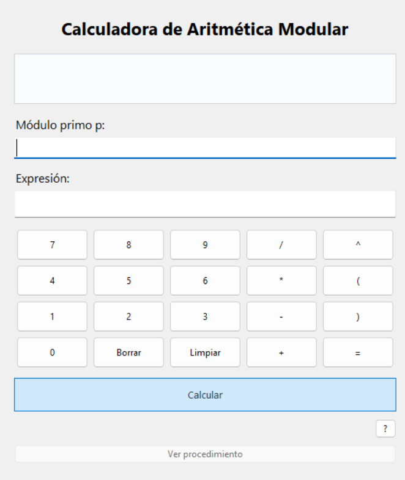
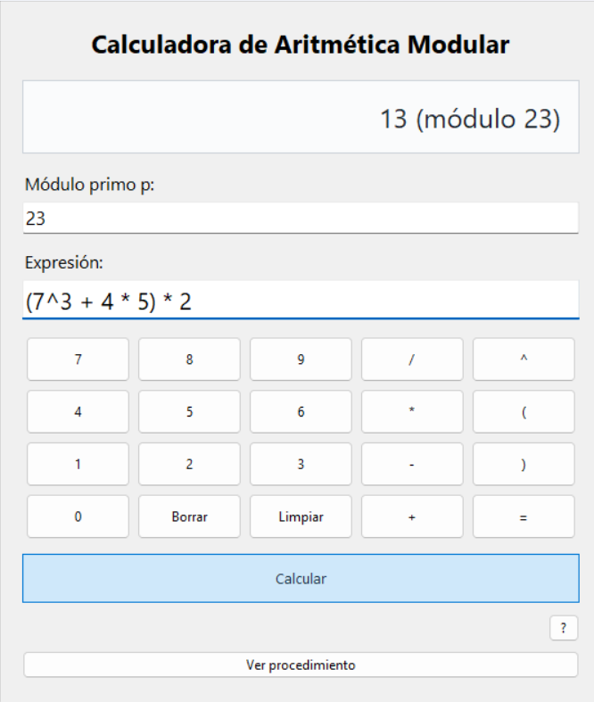

# Calculadora de Aritmética Modular

Ejecutar desde esta carpeta: `python main.py`.
Ejecutar pruebas: `python -m unittest discover -s pruebas -v`.

El dominio implementa operaciones en Z_p y Euclides extendido. La aplicación
coordina validaciones y el adaptador de expresiones; la interfaz solo recoge
entradas y presenta resultados. El analizador construye un árbol sin usar eval.

Los exponentes no se reducen módulo p. Sus expresiones se evalúan con fracciones
exactas y el resultado debe ser entero no negativo (por ejemplo, 2^(6/2)).
Las potencias se asocian a la derecha y preceden al menos unario. Se adopta
0^0 = 1, conforme a pow de Python. No se acepta multiplicación implícita ni + unario.
Las potencias modulares usan pow con tres argumentos.

## Demo

### Vista principal de la calculadora

### Ejemplo de evaluación de una expresión

